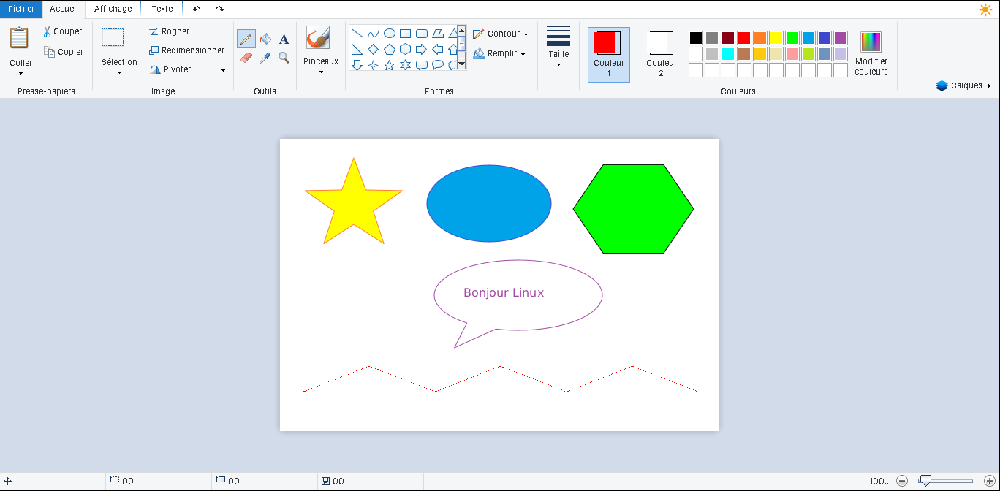
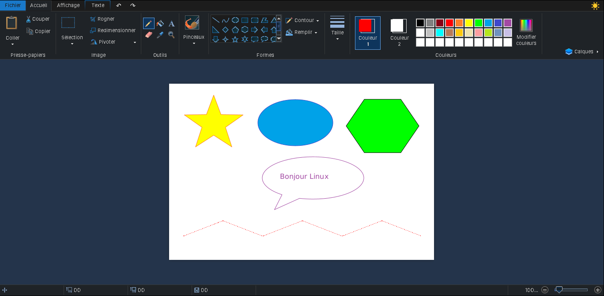
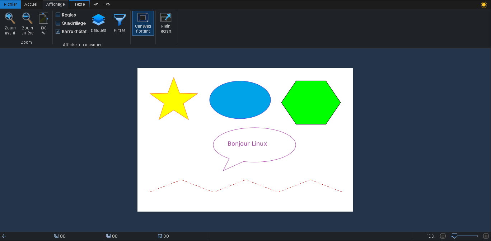
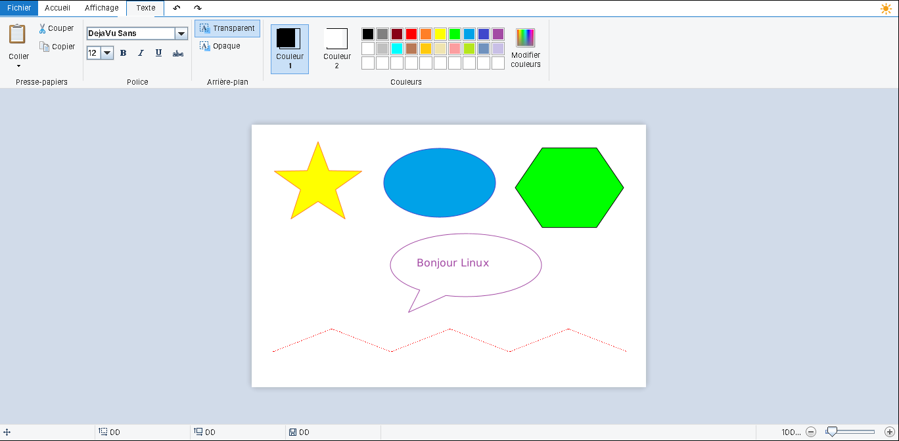
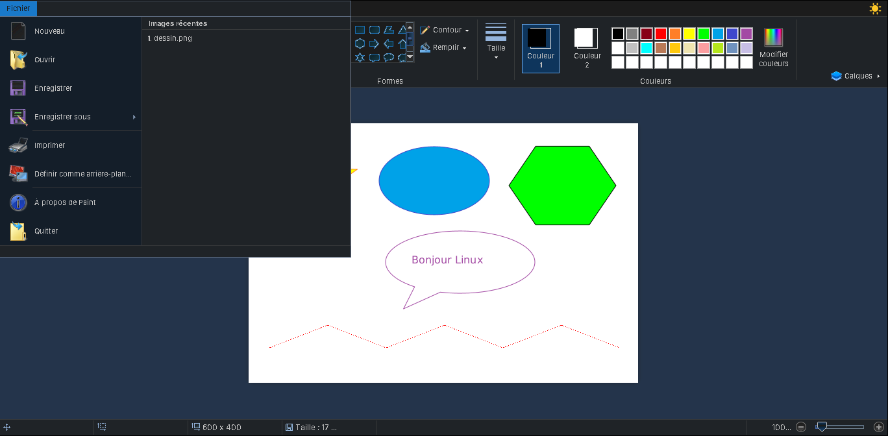

# Paint pour Linux 🎨

Un clone de **MS Paint** (style Windows 7/10) en Java, **réparé, complété et traduit en français** pour Linux.

Le portage Java publié en 2022 était quasi inutilisable sous Linux : interface illisible avec un thème sombre, *Ouvrir* non codé, lignes qui disparaissaient, pas d'annulation, outil Texte et pot de peinture inactifs… Ce dépôt corrige tout ça et ajoute un **mode sombre**.



| Mode sombre | Onglet Affichage (sombre) |
|---|---|
|  |  |

| Outil Texte | Menu Fichier et images récentes |
|---|---|
|  |  |

---

## ✨ Fonctionnalités

- **Annuler / Rétablir** illimité : `Ctrl+Z` / `Ctrl+Y`, plus les boutons ↶ ↷
- **Pinceaux** : crayon, pinceau, calligraphie, aérographe, huile, pastel, marqueur, aquarelle
- **21 formes** (ligne, courbe, polygone, ovale, rectangles, triangles, flèches, étoiles, légendes, cœur, éclair), avec contour et remplissage (couleur unie, pinceau, huile, aquarelle)
- **Texte** : police, taille, gras, italique, souligné, barré, fond transparent ou opaque
- **Pot de peinture**, **gomme**, **pipette**, **loupe**
- **Sélection** rectangulaire ou libre, **couper / copier / coller**, **rogner**
- **Redimensionner** (pourcentage ou pixels), **faire pivoter**, **retourner**
- **Calques**, règles, quadrillage, zoom, plein écran
- Ouvre et enregistre en **PNG, JPEG, BMP, GIF** (TIFF en ouverture)
- **Mode sombre** ☀ (bouton en haut à droite, mémorisé)
- **Interface 100 % en français**
- **Images récentes**, « Définir comme arrière-plan du Bureau » (Cinnamon, GNOME, MATE)

### Raccourcis clavier

| Raccourci | Action | Raccourci | Action |
|---|---|---|---|
| `Ctrl+N` | Nouveau | `Ctrl+Z` | Annuler |
| `Ctrl+O` | Ouvrir | `Ctrl+Y` / `Ctrl+Maj+Z` | Rétablir |
| `Ctrl+S` | Enregistrer | `Ctrl+A` | Sélectionner tout |
| `Ctrl+Maj+S` | Enregistrer sous | `Ctrl+C` / `X` / `V` | Copier / Couper / Coller |
| `Ctrl+P` | Imprimer | `Suppr` | Supprimer la sélection |
| `Échap` | Valider le texte / la forme | `Entrée` | Fermer le polygone |

---

## 💻 Systèmes compatibles

Il faut **Java 8 ou plus récent**. Le paquet `.deb` l'installe automatiquement, et l'archive universelle indique la commande à lancer s'il manque.

| Système | Méthode | Statut |
|---|---|---|
| **Linux Mint** 20, 21, 22 (Cinnamon, MATE, XFCE) | `.deb` | ✅ Testé (Mint 22 Cinnamon) |
| **Ubuntu** 20.04 → 24.04+ et variantes (Kubuntu, Xubuntu, Lubuntu, Ubuntu MATE) | `.deb` | ✅ Testé (Ubuntu 24.04) |
| **Debian** 11, 12, 13 | `.deb` | ✅ Compatible |
| **Pop!_OS, Zorin OS, elementary OS, MX Linux, KDE neon, Kali** | `.deb` | ✅ Compatible (base Debian/Ubuntu) |
| **Manjaro, Arch, EndeavourOS, Garuda** | archive `.tar.gz` | ✅ Compatible |
| **Fedora, Nobara, RHEL/Alma/Rocky** | archive `.tar.gz` | ✅ Compatible |
| **openSUSE** Leap / Tumbleweed | archive `.tar.gz` | ✅ Compatible |
| Toute autre distribution avec Java | archive ou `java -jar MSPaint.jar` | ✅ Compatible |
| Windows / macOS | `java -jar MSPaint.jar` | ⚠️ Fonctionne, non packagé |

**Bureaux** : Cinnamon, GNOME, KDE Plasma, XFCE, MATE, LXQt, Budgie… L'entrée de menu et « Ouvrir avec » suivent le standard freedesktop.org, donc ça marche avec **Nemo, Nautilus, Dolphin, Thunar, Caja, PCManFM**.

**Wayland** : fonctionne via XWayland (comportement standard des applications Java).

---

## 📦 Installation

Les fichiers sont dans la page [**Releases**](../../releases).

### Debian, Ubuntu, Linux Mint et dérivés : paquet `.deb`

Double-clic sur le fichier `.deb` (Gestionnaire de paquets / Logiciels), ou dans un terminal :

```bash
sudo apt install ./mspaint-linux_1.0.0_all.deb
```

Lancement : menu **Graphisme → Paint**, clic droit sur une image → **Ouvrir avec → Paint**, ou la commande `mspaint`.

Désinstallation : `sudo apt remove mspaint-linux`

### Manjaro, Arch, Fedora, openSUSE… : archive universelle

1. Installer Java si nécessaire :
   - Manjaro / Arch : `sudo pacman -S jre-openjdk`
   - Fedora : `sudo dnf install java-21-openjdk`
   - openSUSE : `sudo zypper install java-21-openjdk`
2. Installer Paint :

```bash
tar xzf mspaint-linux-1.0.0.tar.gz
cd mspaint-linux-1.0.0
./install.sh          # pour ton utilisateur seulement
# ou : sudo ./install.sh   pour tout le système (/usr/local)
```

Désinstallation : `./install.sh --uninstall` (ou `sudo ./install.sh --uninstall`).

### Sans installation

```bash
java -jar MSPaint.jar [image.png]
```

---

## 🛠️ Compiler depuis les sources

Prérequis : un **JDK 8+** (`javac`, `jar`) et `dpkg-deb` pour le paquet Debian.

```bash
git clone <url-de-ce-dépôt>
cd mspaint-linux
./build.sh
```

Le script produit dans `build/` :
- `MSPaint.jar` : le programme corrigé
- `mspaint-linux_1.0.0_all.deb` : le paquet Debian/Ubuntu/Mint
- `mspaint-linux-1.0.0.tar.gz` : l'archive universelle

### Organisation du dépôt

```
upstream/MSPaint-original.jar   le jar d'origine (2022), non modifié
src/mspaint/...                 les correctifs (remplacent ou complètent les classes d'origine)
  ├─ MainLauncher.java          démarrage, thème Swing, langue, ouverture en argument
  ├─ action/file/               Ouvrir / Enregistrer / Imprimer / Fond d'écran
  ├─ action/home/ShapeAction    tracé des formes (correction du bug des lignes)
  └─ fix/                       annuler, texte, pot, polygone, courbe, gomme,
                                rogner/pivoter, mode sombre, traduction, images récentes
packaging/                      .desktop, lanceur, contrôle Debian, install.sh universel
icons/                          icône de l'application (16 → 512 px)
docs/captures/                  captures d'écran
```

Le jar final est le jar d'origine, avec les classes de `src/` compilées par-dessus.

---

## 🙏 Crédits

- Portage Java d'origine de MS Paint (2022) : auteur du paquet `com.gmail.mohitsainiknl2`
- Bibliothèque graphique [Pumpernickel](https://github.com/mickleness/pumpernickel)
- Corrections, nouvelles fonctions, mode sombre, traduction et paquets : **Jérémy LAVET**

*Projet non affilié à Microsoft. « Microsoft Paint » est une marque de Microsoft Corporation.*
